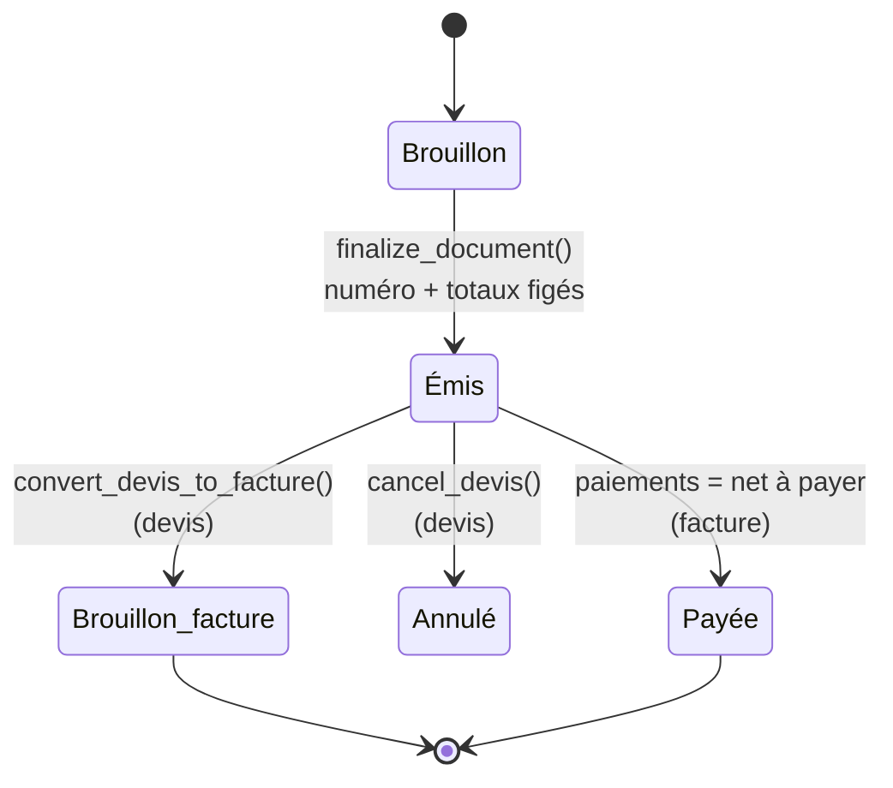
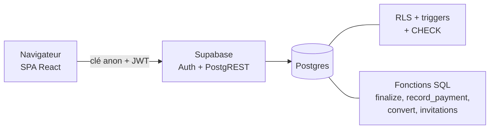

<p align="center">
  
</p>

<p align="center">
  <b>Devis et factures pour les freelances et petites entreprises en Tunisie.</b><br>
  <sub>React · TypeScript · Supabase · TND à 3 décimales</sub>
</p>

---

## En bref

Facturek permet de créer des **devis**, de les convertir en **factures**, d'**émettre** ces
documents avec une numérotation légale sans trou, et de suivre les **paiements**.
L'interface est en français, et l'arabe est prévu.

> 🇹🇳 **بالعربي:** Facturek تطبيقة ويب للفريلانسرز والشركات الصغيرة في تونس، تخليك تعمل
> devis و factures، تحوّل devis لفاكتورة، ترقّم الوثائق بلا فراغات، وتتبّع الخلاص.
> الحسابات بالمليم (3 أرقام بعد الفاصل) ومحمية في قاعدة البيانات.

## Fonctionnalités

| | |
|---|---|
| 🧾 **Devis et factures** | Brouillons modifiables, lignes, TVA par taux, droit de timbre |
| 🔢 **Numérotation** | Attribuée par Postgres seulement, sans trou, par organisation, par type et par année |
| 🔒 **Documents émis figés** | Après émission, plus rien ne change, même pour un administrateur de la base |
| 🔁 **Devis vers facture** | Une seule facture par devis, créée comme brouillon |
| 💰 **Paiements** | Paiements partiels, jamais de trop-perçu, passage automatique à « payée » |
| 👥 **Organisations et rôles** | `owner`, `admin` et `member`, avec des invitations |
| 🛡️ **Sécurité** | RLS sur chaque table, CSP stricte, aucune clé secrète côté client |

## Cycle de vie d'un document



## Architecture



Comme c'est une SPA, **la base de données est la seule vraie barrière** :

- les règles métier sont des triggers et des contraintes, qui s'appliquent à tous les rôles ;
- l'interface ne fait que cacher ce que Postgres refuserait de toute façon.

### L'argent

- En SQL, les montants sont en `numeric(12,3)`.
- En TypeScript, ce sont des millimes entiers, calculés en `bigint`. Il n'y a jamais de float.
- La règle d'arrondi existe **une seule fois** en SQL (`private.compute_totals`).
- Le module TypeScript `src/lib/money` est vérifié contre Postgres avec des vecteurs de test.

## Stack

React + Vite · TypeScript strict · Tailwind · React Router · TanStack Query ·
React Hook Form + Zod · Supabase (Auth, Postgres, RLS) · Vitest · pgTAP · react-i18next

## Démarrage local

Prérequis : Node.js, npm et Docker (pour Supabase en local).

```bash
npm install
```

```bash
npm run db:start
```

```bash
npm run db:reset
```

Copiez ensuite `.env.example` vers `.env`, puis renseignez l'URL et la clé **anon** affichées
par `db:start`. L'application refuse de démarrer avec une clé secrète.

```bash
npm run dev
```

## Tests

| Commande | Ce qu'elle vérifie |
|---|---|
| `npm run test` | Tests unitaires et de composants (Vitest) |
| `npm run test:coverage` | 100 % de couverture du module money |
| `npm run test:db` | Tests pgTAP des migrations, RLS et triggers |
| `npm run test:concurrency` | Appels simultanés à `finalize_document()` sur de vraies connexions |
| `npm run test:e2e-*` | Auth, réglages, documents, lignes et paiements via les API locales |
| `npm run lint` / `npm run typecheck` | ESLint et TypeScript |

## Structure

```
src/app/          routeur, providers, gardes de routes
src/features/     un dossier par module (auth, documents, clients, ...)
src/lib/money/    calculs monétaires (pur, bigint)
src/locales/      traductions
supabase/         migrations, tests pgTAP, templates d'e-mail
docs/             état du projet (STATUS.md) et notes de conception
```

## État du projet

Le projet est en développement et n'est pas encore déployé. Voir
[`docs/STATUS.md`](docs/STATUS.md).

> ⚠️ Les taux de TVA, le droit de timbre et les règles d'arrondi doivent être validés par un
> expert-comptable. Aucun taux n'est codé en dur : ils se configurent dans l'application.
